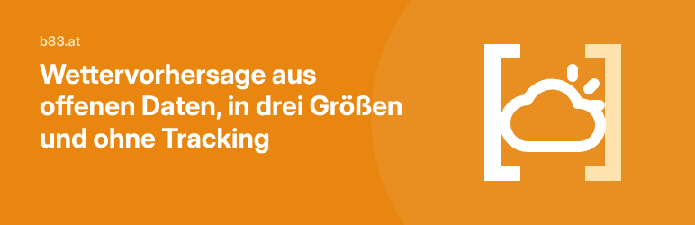

# b83 Wetter

Wettervorhersage für WordPress aus offenen Daten von **GeoSphere Austria** und **MET Norway** – mit vier Darstellungen, frei gestaltbar, ohne Tracking.

Ein Plugin von [b83 – Strategisches Online Marketing](https://b83.at).

## Funktionen

- **Klein** – einzeilig (Icon + Temperatur), passt neben die Navigation
- **Kompakt** – aktuelles Wetter und die nächsten Tage, für Kopfzeile und Sidebar
- **Symbol** – großes Icon mit Temperatur, Wetterlage darunter; zentriert, links oder rechts ausgerichtet, Wetterlage und Ortsname ein- oder ausblendbar
- **Ausführlich** – Wetterseite mit Details (Wind, Böen, Luftfeuchte, Niederschlag, Schneefallgrenze) und bis zu 7 Tagen
- Vier Icon-Sets: farbig, Linie, Duoton, flach
- Farben (Vordergrund, Nebentext, Hintergrund, Rahmen, Akzent), Schrift- und Icon-Größen je Darstellung – im Backend mit Live-Vorschau, per Shortcode oder im Elementor-Widget
- Hauptquelle GeoSphere Austria (1 km, rund 2,5 Tage), Fallback und Ergänzung weiterer Tage durch MET Norway
- Bis zu 4 weitere Orte neben dem Hauptort (z. B. Tal und Berg), jeweils mit eigenen Wetterdaten; Auswahl per Shortcode-Attribut `standort` oder im Elementor-Widget
- Abruf nur über den Server (WP-Cron), Besucher verbinden sich nie mit einem Wetterdienst

## Einrichtung

1. Plugin installieren und aktivieren
2. **b83 → Wetter → Standort und Daten**: Ort suchen oder Breite/Länge eintragen, Seehöhe optional, speichern
3. **Design**: Icon-Set, Farben und Größen festlegen
4. Shortcode oder Elementor-Widget „b83 Wetter“ einbinden
5. Optional: Wetterseite auswählen – klein, kompakt und Symbol verlinken dann dorthin

## Shortcode

```
[b83_wetter ansicht="klein"]
[b83_wetter ansicht="klein" farbe="#ffffff" schrift="14" inhalt="minmax"]
[b83_wetter]
[b83_wetter ansicht="kompakt" tage="0"]
[b83_wetter ansicht="symbol"]
[b83_wetter ansicht="symbol" standort="karkogel"]
[b83_wetter ansicht="symbol" symbol_align="left" symbol_place="1"]
[b83_wetter ansicht="ausfuehrlich" tage="5" iconset="linie"]
```

| Attribut | Bedeutung | Werte |
| --- | --- | --- |
| `ansicht` | Darstellung | `klein`, `kompakt` (Standard), `symbol`, `ausfuehrlich` |
| `farbe` | Textfarbe | `#ffffff`, `rgba(…)`, `inherit` |
| `hintergrund` | Hintergrund | `#0b3954`, `transparent` |
| `schrift` | Schriftgröße (px) | 10–40 |
| `temperatur` | Schriftgröße der Temperatur (px) | 14–120 |
| `icongroesse` | Icon-Größe (px) | 12–200 |
| `abstand` | Innenabstand (px) | 0–80 |
| `tage` | Tage (kompakt: Folgetage, ausführlich: inkl. heute) | 0–5 / 1–7 |
| `inhalt` | Inhalt der kleinen Darstellung | `temp`, `temp_cond`, `minmax`, `place` |
| `iconset` | Icon-Set | `farbig`, `linie`, `duoton`, `flach` |
| `akzent` | Akzentfarbe | Farbe |
| `standort` | Weiterer Ort (Kennung aus b83 → Wetter → Standort und Daten); leer = Hauptort | z. B. `karkogel` |
| `titel` | Ortsname überschreiben (auch `ort`) | Text |
| `link` | Link (klein, kompakt, Symbol) | URL, Seiten-ID oder `none` |
| `class` | Eigene CSS-Klasse | Text |

Zusätzlich lassen sich alle Design-Felder mit ihrem Schlüssel setzen, z. B. `small_content="minmax"` oder `detail_card_bg="#ffffff"` (Liste in `src/Design.php`). Fehlt ein Attribut, gilt der Wert aus dem Backend.

## Mehrere Orte

Der Ort unter **b83 → Wetter → Standort und Daten** ist der Hauptort. Darunter lassen sich bis zu 4 weitere Orte eintragen (Kennung, Ortsname, Breite, Länge, Seehöhe). Ohne Attribut `standort` zeigt jedes Widget den Hauptort, bestehende Shortcodes ändern sich nicht. Quelle, Fallback, Aktualisierungsintervall und Design gelten für alle Orte.

- Jeder Ort wird für sich abgerufen und gespeichert. Fällt ein Ort aus, bleiben die anderen unberührt. Unter „Status“ steht jeder Ort mit eigenem Abruf und eigenen Meldungen.
- Kennung: nur Kleinbuchstaben, Ziffern und Bindestrich, höchstens 30 Zeichen. Bleibt sie leer, wird sie aus dem Ortsnamen gebildet. `main` und `haupt` sind reserviert.
- Ein unbekannter `standort` zeigt angemeldeten Redakteuren eine Meldung und Besuchern nichts.
- Jeder weitere Ort bedeutet bis zu zwei zusätzliche Abfragen je Aktualisierung (Hauptquelle und gegebenenfalls Fallback). Zwischen den Orten wartet das Plugin eine Sekunde.
- WPML: Die Ortsnamen der weiteren Orte stehen ebenfalls in der String-Übersetzung.

## CSS

Alle Werte stehen als CSS-Variablen am Widget und lassen sich im Theme überschreiben:

```css
.b83-wetter--klein { --b83w-color: #fff; --b83w-fs: 14px; --b83w-icon: 22px; }
.b83-wetter--ausfuehrlich { --b83w-card: #fff; }
```

Variablen: `--b83w-color`, `--b83w-muted`, `--b83w-bg`, `--b83w-accent`, `--b83w-border`, `--b83w-radius`, `--b83w-pad`, `--b83w-fs`, `--b83w-temp`, `--b83w-icon`, `--b83w-day-icon`, `--b83w-card`, `--b83w-weight`.

## Daten, Lizenz und Datenschutz

- **GeoSphere Austria** – Dataset API, Modell `nwp-v2-1h-1km`, Lizenz CC BY 4.0 (bis 1.3.0: `nwp-v1-1h-2500m`, seit 4.11.2026 ohne neue Läufe)
- **MET Norway** – Locationforecast 2.0, Lizenz NLOD 2.0 / CC BY 4.0; die Bezeichnung „Yr“ und das Yr-Logo werden nicht verwendet

Die Quellenangabe ist Pflicht und wird automatisch ausgegeben (kompakt und ausführlich sichtbar; klein und Symbol als ©-Link oder über den Link zur Wetterseite). Die Daten werden auf dem Server abgerufen (Standard: stündlich) und gespeichert. Besucher-IP-Adressen werden an keinen Dienst übertragen, es werden keine Cookies gesetzt und keine externen Dateien geladen.

Liegt eine Seite länger im Seiten-Cache als das Aktualisierungsintervall, holt sich das Widget aktuelle Werte über den REST-Endpunkt der eigenen Website (`/wp-json/b83-wetter/v1/widget`).

## Sprachen und WPML

Die Texte im Code sind deutsch. Englisch liegt bei (`languages/`, en_US und en_GB) – inklusive Wetterlagen, Wochentage, Datumsformate und Quellenangabe. Das Widget folgt der Sprache der Seite: Auf `/en/` einer WPML-Website erscheint es auf Englisch, auch beim Nachladen über `/wp-json/b83-wetter/v1/widget` (Parameter `lang`).

- Ortsname übersetzen: WPML → String-Übersetzung, Domäne `admin_texts_b83_wetter_settings` (über `wpml-config.xml` registriert)
- Weitere Sprachen: `languages/b83-wetter.pot` mit Poedit übersetzen und als `b83-wetter-<locale>.po/.mo` in `languages/` ablegen – oder in WPML → String-Übersetzung die Domäne `b83-wetter` übersetzen
- Vorlage neu erzeugen: `wp i18n make-pot . languages/b83-wetter.pot --domain=b83-wetter --exclude=.github --skip-js`, danach `wp i18n make-mo languages` und `wp i18n make-php languages`

## Hooks

| Hook | Typ | Zweck |
| --- | --- | --- |
| `b83_wetter_loaded` | Action | Nach dem Laden des Plugins |
| `b83_wetter_settings_saved` | Action | Nach dem Speichern der Einstellungen |
| `b83_wetter_data_updated` | Action | Nach dem Speichern neuer Wetterdaten (Parameter: Daten, Kennung des Orts; `main` = Hauptort) |
| `b83_wetter_purge_cache` | Action | Nach dem Leeren des Seiten-Caches |
| `b83_wetter_sources` | Filter | Datenquellen (eigene Quellen mit `SourceInterface`) |
| `b83_wetter_locations` | Filter | Orte, für die Daten abgerufen werden (Kennung => name, lat, lng, altitude) |
| `b83_wetter_days_needed` | Filter | Tage, für die Daten vorhanden sein sollen |
| `b83_wetter_geosphere_url`, `b83_wetter_metno_url` | Filter | Abfrage-URLs |
| `b83_wetter_user_agent` | Filter | User-Agent der Abfragen |
| `b83_wetter_render_design` | Filter | Design-Werte vor der Ausgabe |
| `b83_wetter_html` | Filter | HTML eines Widgets |
| `b83_wetter_icon_sets` | Filter | Verfügbare Icon-Sets |
| `b83_wetter_icon_svg` | Filter | SVG eines Icons ersetzen |
| `b83_wetter_enqueue_early` | Filter | CSS im `<head>` laden |
| `b83_wetter_purge_post_ids`, `b83_wetter_purge_all` | Filter | Seiten-Cache leeren |
| `b83_wetter_capability` | Filter | Berechtigung für das Backend (Standard `manage_options`) |

## Updates

Neue Versionen kommen über GitHub-Releases. Ablauf: Version in `b83-wetter.php` (Header und `B83_WETTER_VERSION`) und `CHANGELOG.md` erhöhen, auf `main` pushen – die GitHub Action erstellt das Release mit `b83-wetter.zip`.

## Anforderungen

WordPress 6.2+, PHP 8.1+, funktionierendes WP-Cron (oder Server-Cron).
